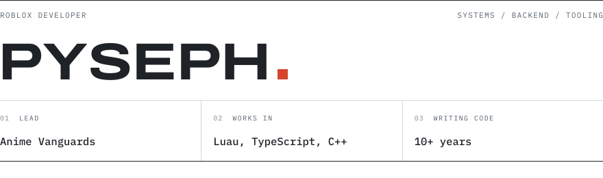
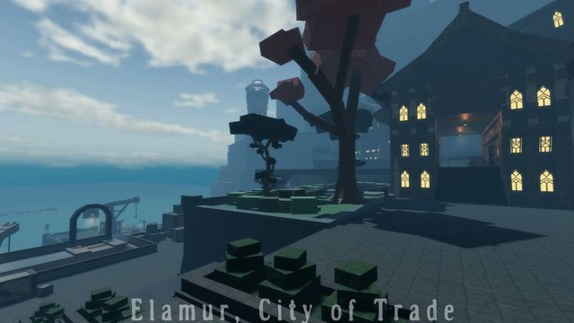
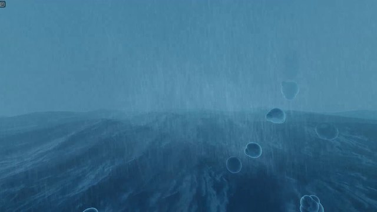
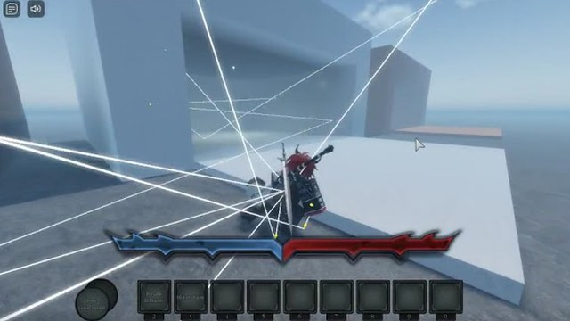

<a href="https://pyseph.sh">
<picture>
  <source media="(prefers-color-scheme: dark)" srcset="assets/header-dark.svg">
  
</picture>
</a>

I'm one of the leads on [Anime Vanguards](https://www.roblox.com/games/16146832113/Anime-Vanguards), and I make the calls on its backend and engineering design. Outside of that I build tools for other Roblox developers.

There's more on [pyseph.sh](https://pyseph.sh).

 

### anime vanguards

<picture>
  <source media="(prefers-color-scheme: dark)" srcset="assets/av-stats-dark.svg">
  
</picture>

A tower defense game from Kitawari. It launched in September 2024 and was the top-earning game on Roblox within ten days. I've been on it since before launch.

- **Backend.** How the game's services are split up, what they own, and how live servers talk to them.
- **Netcode and performance.** Replication, packet budgets, and telemetry from live sessions that shows what's actually slow in production.
- **The team's toolchain.** Our own Luau language server and CI gate, git-backed Team Create sync, typed networking codegen, and an offline renderer that draws Studio's UI exactly, so changes can be previewed and reviewed without opening Studio.

 

### open source

<table>
<tr>
<td valign="top"><a href="https://github.com/Pyseph/PacketProfiler"><b>PacketProfiler</b></a> studio plugin · networking</td>
<td valign="top">Roblox network traffic by frame, with the calls and data behind each spike. Runs in Studio or live.</td>
</tr>
<tr>
<td valign="top"><a href="https://github.com/Pyseph/DataScope"><b>DataScope</b></a> studio plugin · vide</td>
<td valign="top">DataStore editor with tree and code views, version diffs, and a scanner that follows one field back through its history.</td>
</tr>
<tr>
<td valign="top"><a href="https://github.com/Pyseph/ClientCast"><b>ClientCast</b></a> combat</td>
<td valign="top">Raycast melee hitboxes that feel responsive on the client and still hand back exact contact data.</td>
</tr>
<tr>
<td valign="top"><a href="https://github.com/Pyseph/ObjectCache"><b>ObjectCache</b></a> performance</td>
<td valign="top">Typed part and model cache built on <code>BulkMoveTo</code>.</td>
</tr>
<tr>
<td valign="top"><a href="https://github.com/Pyseph/RemotePacketSizeCounter"><b>RemotePacketSizeCounter</b></a> networking</td>
<td valign="top">The serialized byte size of anything you send through a remote.</td>
</tr>
<tr>
<td valign="top"><a href="https://github.com/luau-lang/luau/pull/2992"><b>luau-lang/luau</b></a> contributor · c++</td>
<td valign="top">A type checker change that stops building subtyping reasoning nothing reads, which makes full checks faster.</td>
</tr>
</table>

 

### older experiments

<table>
<tr>
<td width="33%" valign="top">

 <b>Gods' Domain</b>
 Four years of a game that never shipped. Combat, inventory, netcode. <a href="https://devforum.roblox.com/t/gods-domain-public-update-log-1140/1911042">devlog</a>
</td>
<td width="33%" valign="top">

 <b>Ocean simulation</b>
 Gerstner waves on deformed meshes, kept inside Roblox's rendering budget. <a href="https://devforum.roblox.com/t/gods-domain-public-update-log-101/1159139">devlog</a>
</td>
<td width="33%" valign="top">

 <b>Audio reverb</b>
 Raycasts bounce sound around the room; material and distance shape the echo. <a href="https://devforum.roblox.com/t/realtime-audio-reverb-system-immersive-echo-and-reverb-for-all-3d-audio/1883799">writeup</a>
</td>
</tr>
</table>

 

[writing](https://pyseph.sh/blog) &nbsp;·&nbsp; [devforum](https://devforum.roblox.com/u/pysephdev/summary) &nbsp;·&nbsp; [youtube](https://www.youtube.com/@Pyseph) &nbsp;·&nbsp; [résumé](https://pyseph.sh/Pyseph-Resume.pdf) &nbsp;&nbsp;&nbsp; plus 35 projects I can't show you
